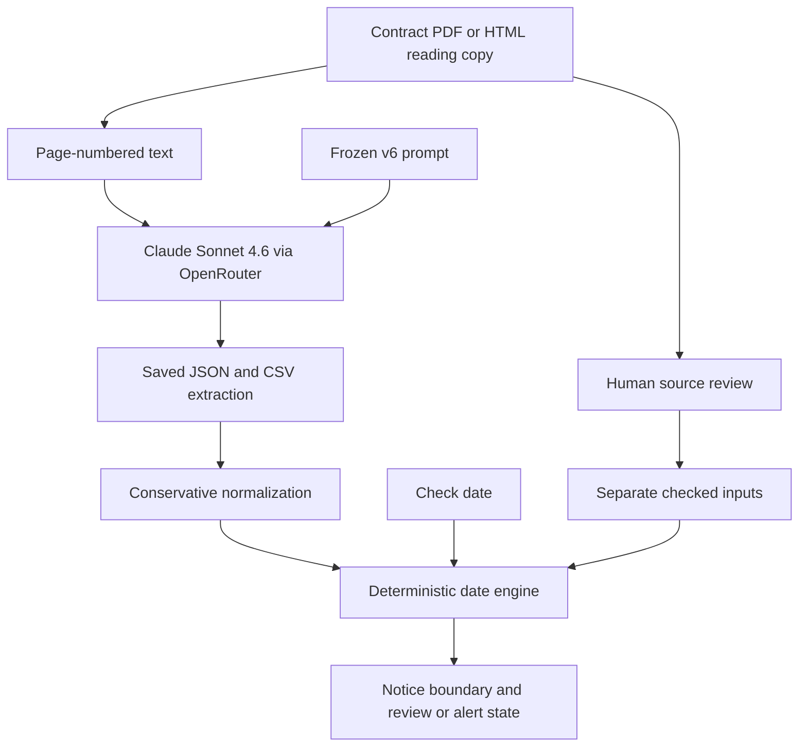

# Renewal Radar product documentation

## Persona and value

A procurement/legal-operations analyst managing about 150 vendor contracts across shared folders and spreadsheets. The task is to find renewal obligations early enough to review, renegotiate or send notice. The prototype extracts varied language with an LLM, calculates notice dates in code and marks unresolved cases for a person.

## Input and output

Inputs: one public contract/amendment's page-numbered extracted text, frozen v6 prompt, and a check date for deadline comparison. Outputs: effective date, term-start wording, term/end wording, canonical renewal category, conditions, notice amount/unit/actor/purpose, notice type, calculability, review flag/reason and page evidence. Normalization produces structured date-rule inputs. Date code produces a notice boundary/window and review/alert state.

## Architecture

The LLM identifies wording; the code owns arithmetic. Source review provides a separately labelled lane. The original prompt forbids model calendar arithmetic, but some outputs violated that instruction; their text is preserved and the deterministic engine computes independently. No RAG retrieval, autonomous action agent, calibrated confidence score or automatic cancellation/renewal was implemented.

## Targets and reached metrics

The proposal targeted correct expiry, notice and auto-renewal extraction, improvement over Always Yes/keywords, and honest abstention. It did not specify a numeric acceptance threshold; do not invent one retrospectively. Achieved historical results: category 38/40; eligible binary 34/34 vs Always Yes 21/34 and retrospective keywords 30/34; only four confirmed cutoffs eligible, 4/4 matched. Additional15 had expiry 15/15, category 14/15 and manually adjudicated primary notice 15/15. All sample scopes and denominators are explained in evaluation/README.md.

## Operational limits and future path

This package is a batch prototype, not a live reminder service. Actual current terms, later amendments, business-day calendars, notice delivery buffers, eligibility events and base agreements may need review. Multiple notice rights should eventually be structured separately by actor, purpose, trigger and anchor. A next version should validate that schema and then be tested on a new independently held-out set. A controlled business pilot could measure review time and missed-window reduction; those outcomes were not measured here.
